# BrokerForge how-to guide

Use a REST API from Dataverse the way K2 uses a service through SmartObjects: add a connection, answer BrokerForge's questions about the API, generate a table, and use it in lists and forms. All of it happens in the BrokerForge app in Dataverse.

*Screenshots come from the BrokerForge dev environment and its mock APIs. Host and environment names are replaced with contoso placeholders. The video `tools/media/out/brokerforge-how-to.mp4` walks through the same steps, with subtitles.*

## Contents

- [If you know K2](#if-you-know-k2)
- [Part 1: add a REST connection (administrators)](#part-1-add-a-rest-connection-administrators)
- [Part 2: connect your account (everyone)](#part-2-connect-your-account-everyone)
- [Where things live](#where-things-live)
- [When something goes wrong](#when-something-goes-wrong)

## If you know K2

| In K2 you… | In BrokerForge you… | Step |
| --- | --- | --- |
| Create a service instance: URL and authentication | Add a connection: base URL and authentication | 1 |
| Point it at the service's description | Paste the service's Swagger (OpenAPI) definition into the connection | 1 |
| Check the service objects K2 found | Review the endpoints and answer BrokerForge's questions | 2 |
| Generate SmartObjects | Click Generate: table, columns, view, form, actions and a security role | 3 |
| Enter the service account's password | Set the key on the host's page | 4 |
| Use the SmartObject in views and forms | Use the table in Dataverse lists and forms | 5 |
| Users enter their own credentials (OAuth, SSO) | Users connect their account on the connect page | Part 2 |

One difference: where a definition leaves a gap, such as how results are paged or which filters really work, BrokerForge asks rather than guessing. An endpoint isn't used until its questions are answered.

## Part 1: add a REST connection (administrators)

You need the `BrokerForge administrator` role in the environment, and BrokerForge installed there (a one-off step, like installing a K2 server). Open the **BrokerForge** app and go to **Connections**.

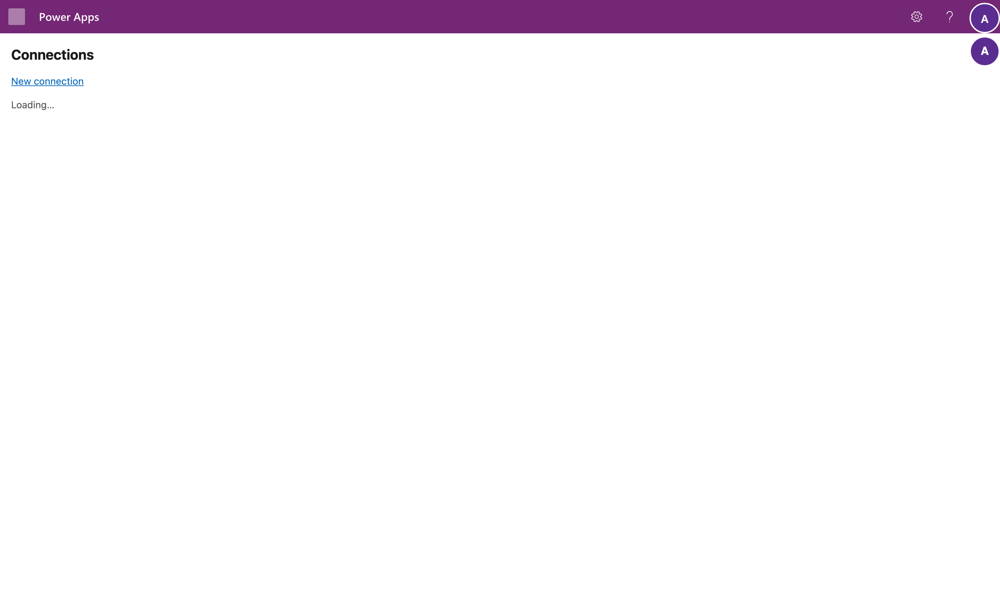

The example connects an inventory API.

### Step 1: add the connection

Select **New connection** and fill in:

- **Name**, the name of the source, for example `InventoryAPI`;
- **Base URL**, where the API is;
- **Authentication** and the settings that mode needs. This API takes a key in its query string: Static, kind `apiKeyQuery`, query parameter `api_key`;
- **Table prefix**, your publisher's prefix, for example `ext`;
- **Swagger / OpenAPI**: paste the API's definition, YAML or JSON.

A key or password is never typed into this form. You set it on the host's page in step 4. Save the connection.

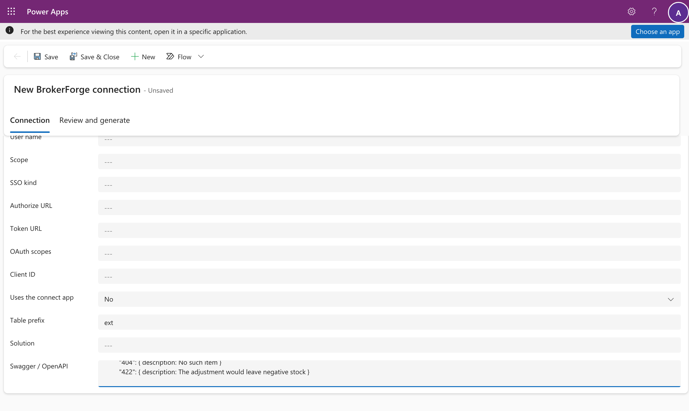

### Step 2: review and answer

Open the **Review and generate** tab and select **Save and read the definition**. BrokerForge lists the table it proposes, with every column, and every endpoint with what it becomes: list, open, new, save, delete or an action. You can untick an endpoint, and rename columns.

Where the definition leaves a gap, a question appears under its endpoint: how results are paged, which filters the API really supports, whether its order is stable, how many decimal places a price has, where an error's message is. **Generate** stays disabled until every ticked endpoint is ready.

Answer them and select **Save answers and check**. When everything is ready, the page shows exactly what Generate will create or change.

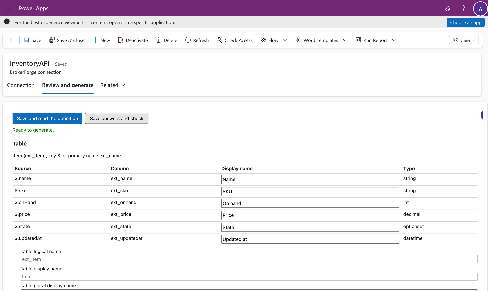

### Step 3: generate

Select **Generate**. It runs in the background and the page follows it. It creates, in a solution named for the source:

- the virtual table and every column;
- a view and a main form that show every column;
- a Custom API for each action;
- a security role, `<Name> user`, with the privileges the endpoints allow.

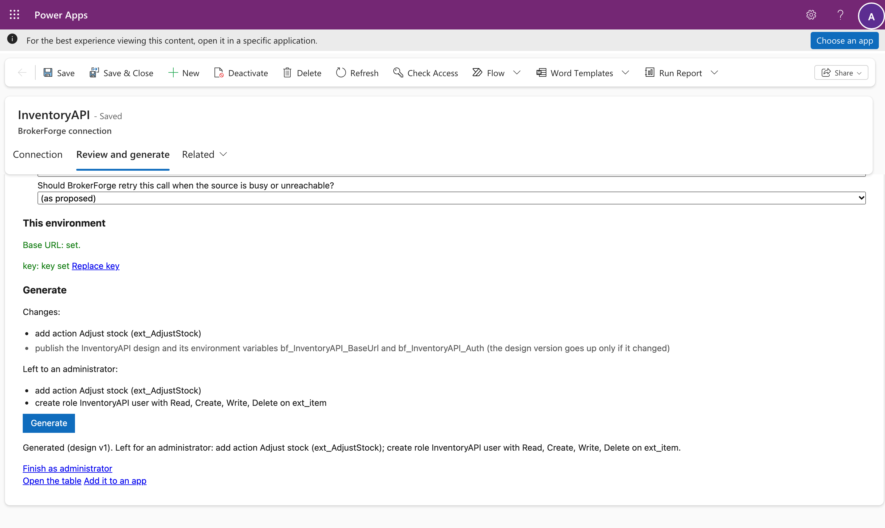

Two steps need an administrator's own rights: giving the role its privileges, and creating actions. The page lists them and offers **Finish as administrator**. It opens the host's page; select **Do it as me**, sign in for Dataverse (the first time, you're asked to allow BrokerForge Connect to access Dataverse as you), and both are done as you.

If you change the definition later, **Save and read the definition** again: the page lists what would change (a column added, removed or changed) before anything is applied. A column that something outside BrokerForge still uses, such as a hand-made view, is blocked and named, and nothing is applied until it's free.

### Step 4: set the key

The connection shows **needs key**. Select **Set key**: the host's page opens, you sign in, and you enter the key there. It's stored encrypted by the host and never enters Dataverse. Back on the connections page the connection is **ready**.

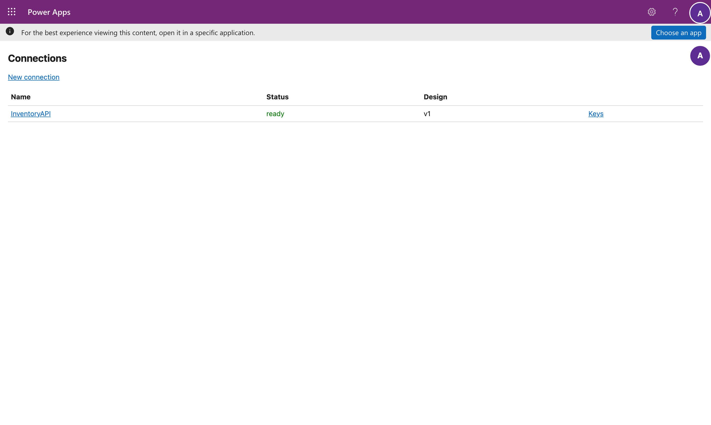

### Step 5: use the table

The table lists rows straight from the API, and opening a record reads it. Save, New and Delete go to the API too. Nothing is copied into Dataverse.

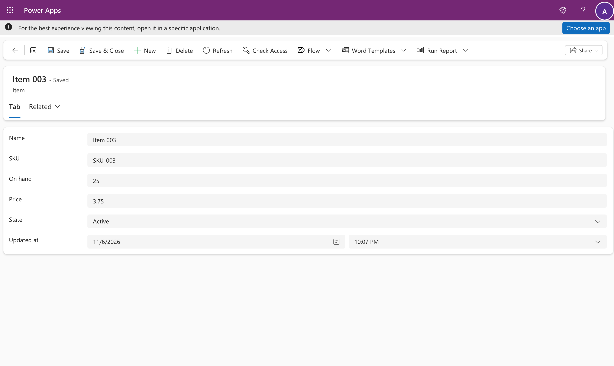

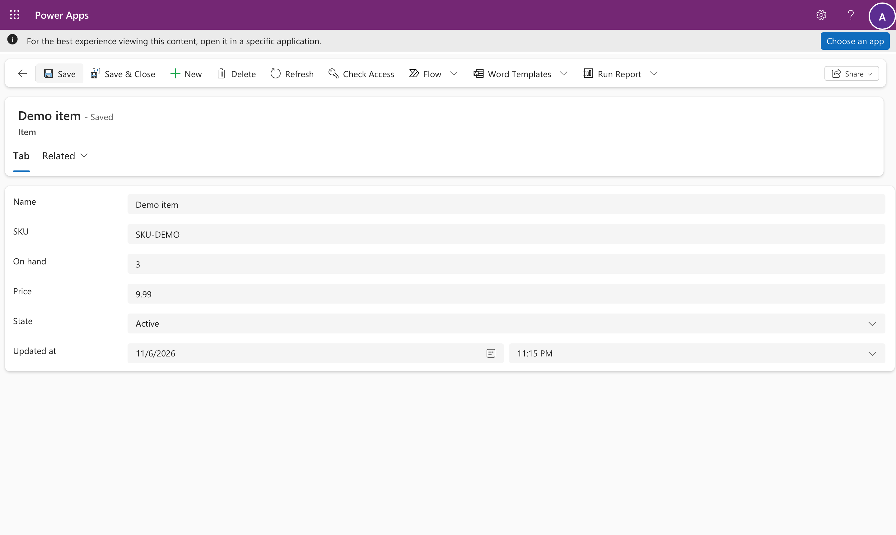

### Test and production

The connection travels in its solution. Export it from dev and import it into test. There, set the environment variable `bf_<Name>_BaseUrl` if the API's address differs, then set the key on the connections page. Until then the connection says **needs URL** or **needs key**, and its tables fail with a configuration error naming what is missing. They never call the dev API.

### What fails, and why

BrokerForge never returns partial or guessed results. A filter, sort or operator that wasn't declared in the answers is refused with a named error and a correlation ID for the host logs.

### Per-user services

When each person must see only their own data, choose a per-user mode:

| Mode | The user | The host sends |
| --- | --- | --- |
| OAuth | signs in to the service once | that user's token from the service |
| Impersonate | signs in with their work account | a Microsoft Entra token for the service, as that user |
| SSO | enters their username and password for the service | those |

Give users the generated role, and send them the connect page: `https://<host>/connect/<Name>`. There is no fallback: a user who hasn't connected gets a message asking them to, never someone else's data.

## Part 2: connect your account (everyone)

The example is the Tickets table: each person sees the tickets their own Tickets account can see.

1. Open the table. Until you connect, it shows an error with the connect page address instead of rows.

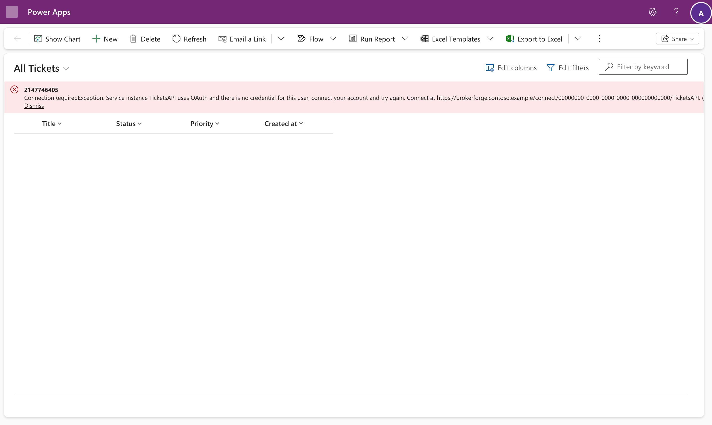

2. Open that address. It signs you in with your work account and shows your connection's status. Select **Connect**.

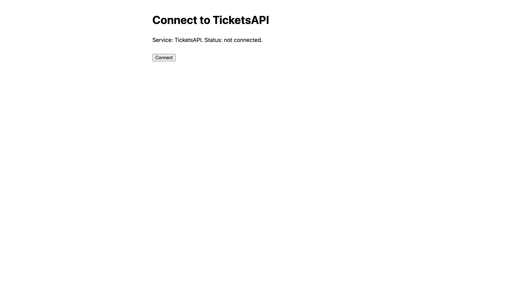

3. Sign in to the service. (The demo service has its own simple page; a real one shows its own.)

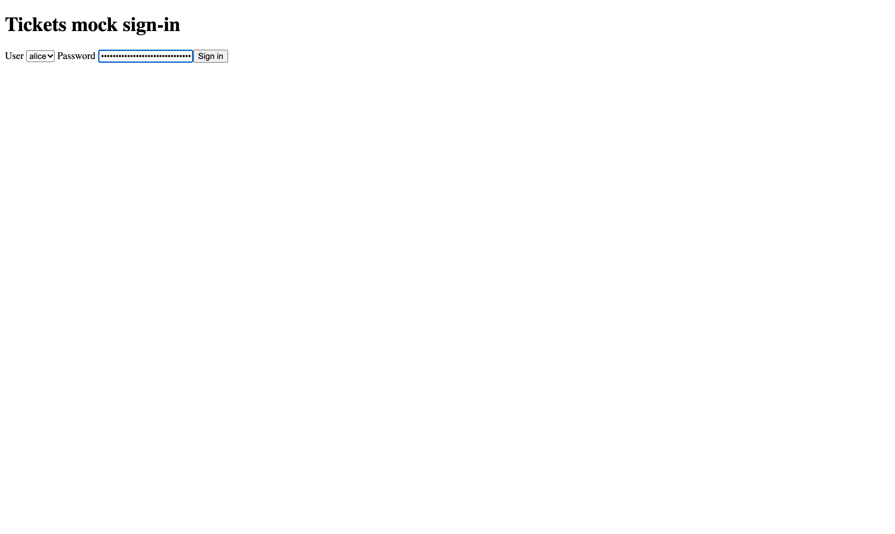

4. You're back on the connect page: connected. Your sign-in is stored encrypted, for you only, and renewed when it expires.

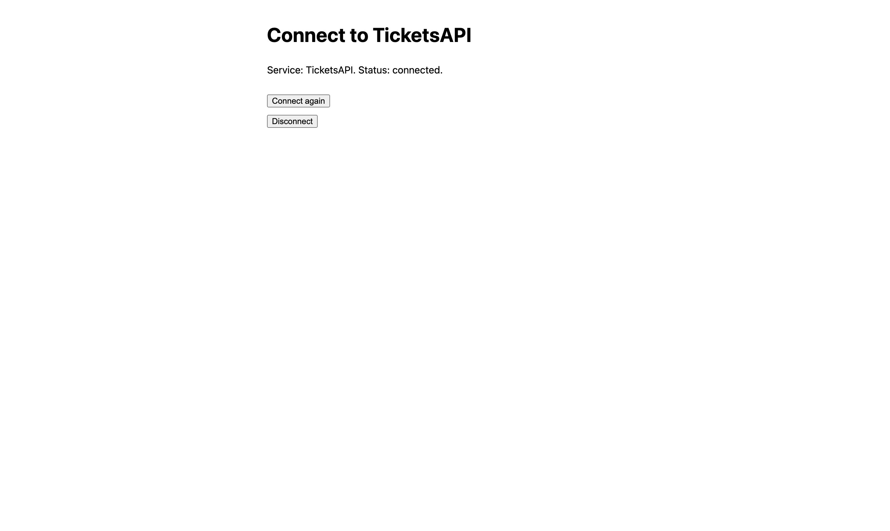

5. Refresh the table: it shows your tickets. Records open on a form as usual.

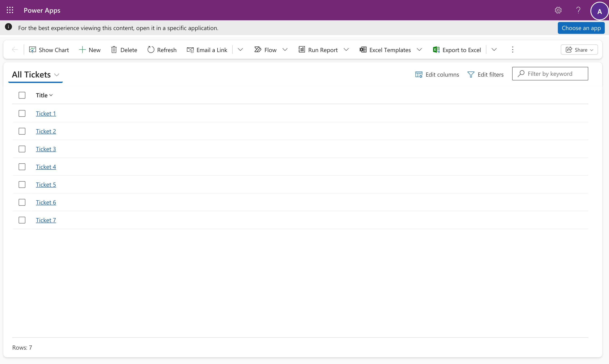

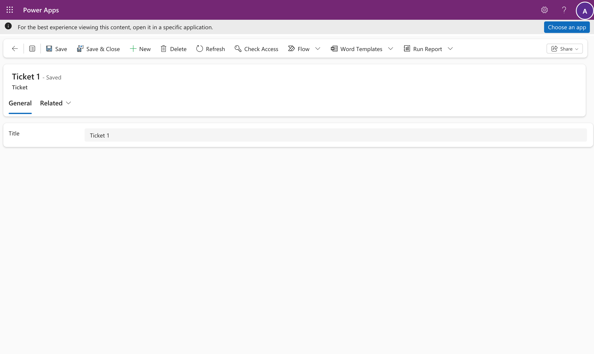

6. The rows follow the account you connected. Connected as a different account at the service, the same table shows that account's tickets instead: each person sees their own.

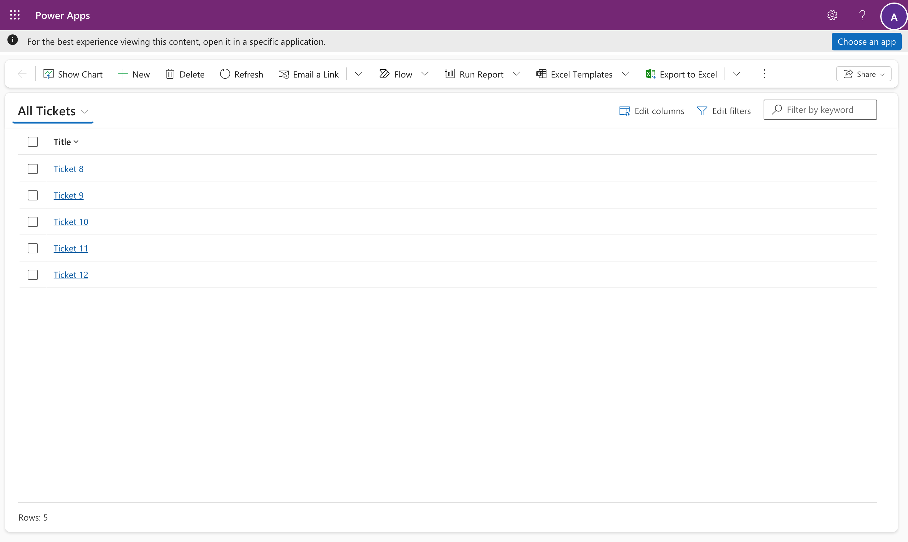

7. To disconnect, open the connect page and select **Disconnect**. The list and forms ask you to connect again.

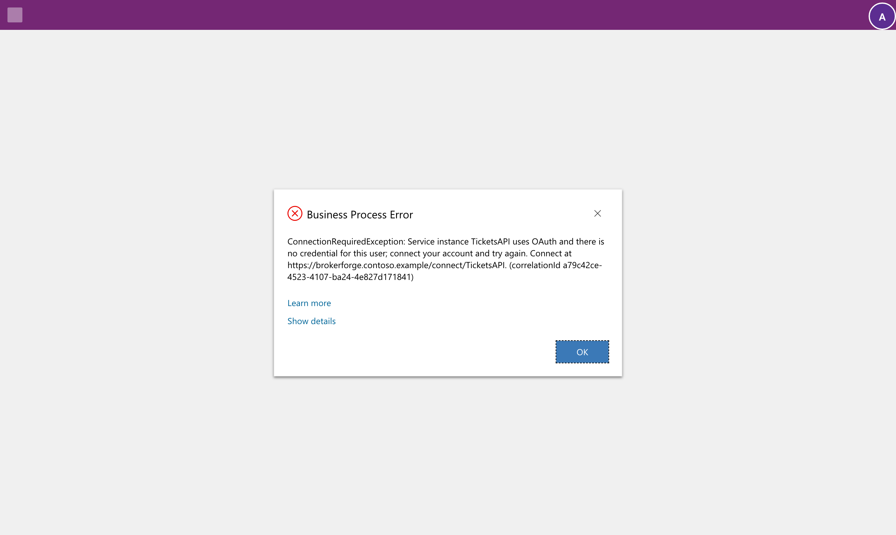

> Sign in to the connect page with the same work account you use in Dataverse. If someone else is signed in to Microsoft in your browser, use a private window.

## Where things live

| What | Where |
| --- | --- |
| What you typed: name, URL, authentication, definition, answers | The connection row, in the environment you set it up in |
| What runs: the descriptors and table schema BrokerForge made | The connection's design, in the source's solution |
| Base URL in each environment | Environment variable `bf_<Name>_BaseUrl` |
| API keys and secrets | The host's encrypted store (set on the host's page) |
| Users' connections | The host's encrypted store |

## When something goes wrong

| Message | Meaning | What to do |
| --- | --- | --- |
| `ConnectionRequiredException` | You haven't connected to this per-user service, or the connection expired | Open the connect page in the message |
| `UnsupportedQueryException` | That filter, sort or operator isn't declared | Use a declared one, or ask an administrator to allow it in the connection's answers |
| `SourceException` | The service answered with an error | Give the correlation ID to an administrator |
| `SourceTimeoutException` | The service didn't answer in time | Try again |
| `BrokerUnavailableException` | Dataverse couldn't reach BrokerForge | Try again; in dev the first call after a pause takes about 25 seconds |
| `ConfigurationError`: the source "needs its base URL" or "needs its key" | The connection arrived in this environment without its URL or key | An administrator sets the variable, or the key on the connections page |
| `MappingException` | The service's answer didn't match its definition | An administrator checks the definition and reads it again |

Every message ends with a correlation ID, which finds the request in the host logs.
