# BrokerForge how-to guide

Use a REST API from Dataverse the way K2 uses a service through SmartObjects: describe the service, register an instance of it, then generate a table and use it in lists and forms.

*Screenshots come from the BrokerForge dev environment and its mock APIs. Host and environment names are replaced with contoso placeholders. Command output is from real runs. The video `tools/media/out/brokerforge-how-to.mp4` walks through the same steps, with subtitles.*

## Contents

- [If you know K2](#if-you-know-k2)
- [Part 1: add a REST service (administrators)](#part-1-add-a-rest-service-administrators)
- [Part 2: connect your account (everyone)](#part-2-connect-your-account-everyone)
- [Where files live](#where-files-live)
- [When something goes wrong](#when-something-goes-wrong)

## If you know K2

| In K2 you… | In BrokerForge you… | Step |
| --- | --- | --- |
| Register a service type and point it at the service's description | Draft descriptors from the service's Swagger (OpenAPI) file | 1 |
| Create a service instance: URL and authentication | Add the instance to the host settings: base URL and authentication | 2 |
| Generate SmartObjects from the service objects | Generate the virtual table (and Custom APIs) | 3 |
| Use the SmartObject in views and forms | Use the table in Dataverse lists and forms | 3 |
| Users enter their own credentials (OAuth, SSO) | Users connect their account on the connect page | Part 2 |

Two differences. A descriptor is a small YAML file you can read and change, where K2 keeps the service object inside the broker. And the instance settings are host settings, deployed with the host; they move into Dataverse later (phase 2b), when they become editable without a deploy.

## Part 1: add a REST service (administrators)

You need the repository, the .NET 10 SDK, the az CLI signed in to the tenant, and BrokerForge already deployed (`tools/dev/deploy.sh`, then `tools/dev/setup-dataverse.sh`). `bf` below is the BrokerForge CLI: `dotnet run --project tools/BrokerForge.Cli --`.

The example adds an inventory API as a new service called WarehouseAPI. The dev environment already has the same API added as InventoryAPI, so the Dataverse screens show that one.

### Step 1: describe the service

1. Save the service's Swagger (OpenAPI) file in the repository as `openapi/WarehouseAPI.yaml`. It is read once, here; it is never deployed.
2. From the repository root, run:

   ```
   bf draft openapi/WarehouseAPI.yaml --instance WarehouseAPI --prefix ext --table ext_stockitem --out drafts
   ```

   This writes one descriptor per operation in `descriptors/WarehouseAPI/`, the table's columns in `schemas/WarehouseAPI.yaml`, and a short report.

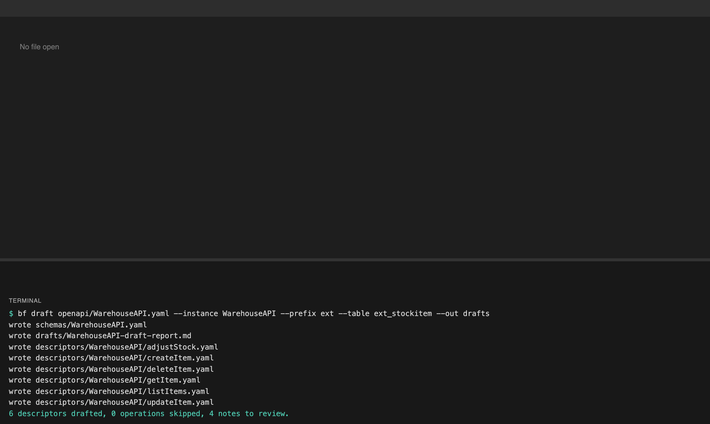

3. Read the report's "To review" notes and answer them. Here there are four; the one that needed a change is `sortStable`, set to `true` because this API always returns items in the same order.

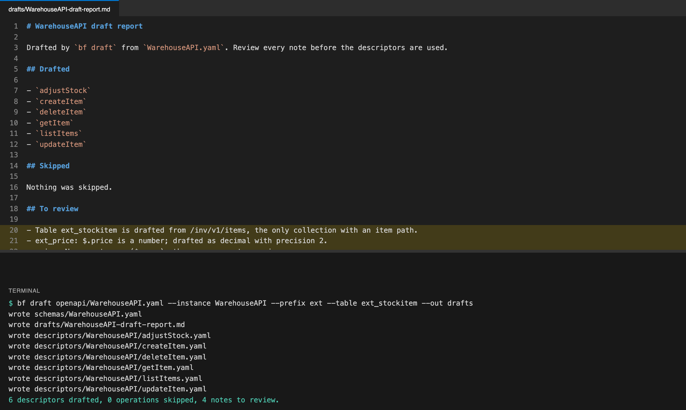

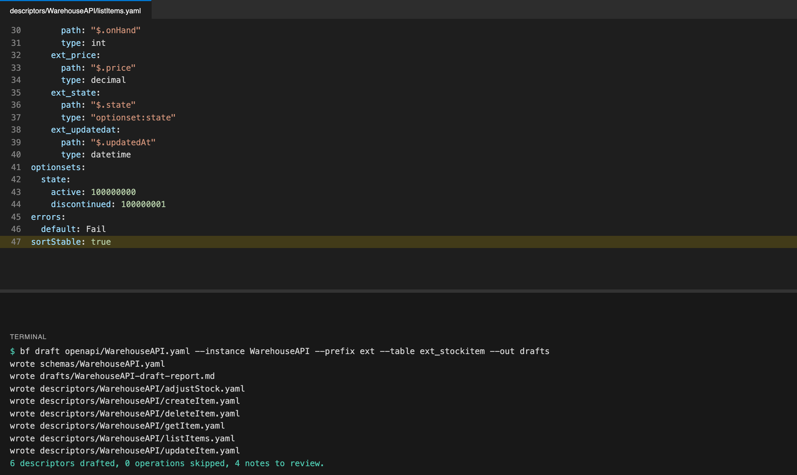

4. Tidy the display names in the schema ("Stock item", "SKU"): they are what people see in Dataverse.

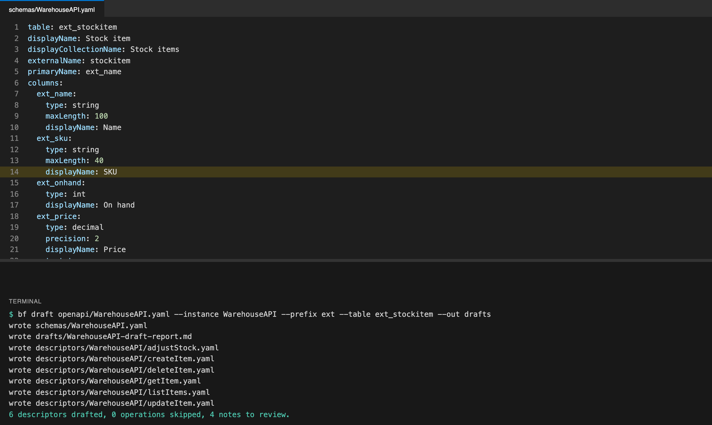

5. Check everything:

   ```
   bf validate descriptors --schemas schemas
   ```

   A mistake names the file and the field. Fix it and run again until all are valid.

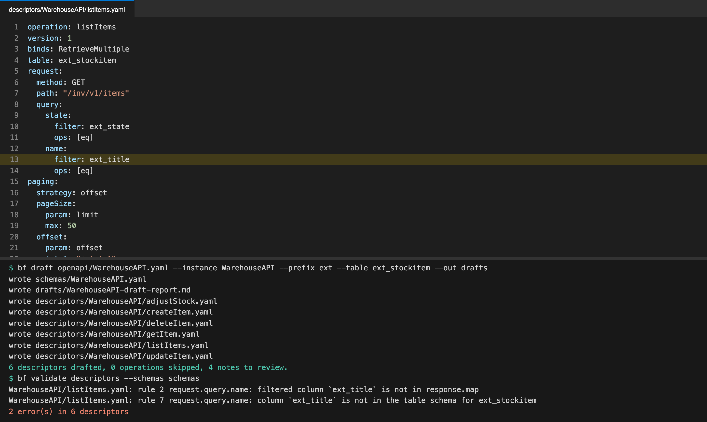

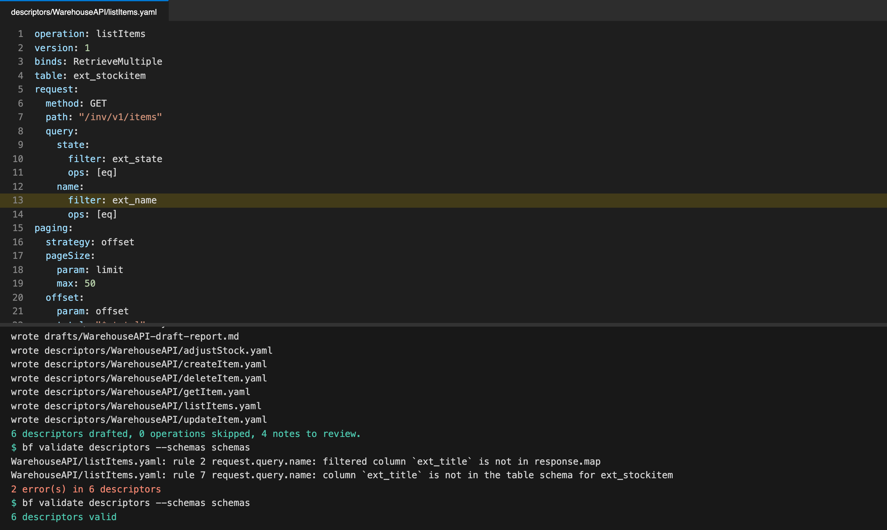

### Step 2: register the service instance

1. Add the instance to the host settings (`infra/containerApps.bicep` in dev): the base URL and how to sign in. WarehouseAPI uses an API key; the setting holds a Key Vault reference, never the key.
2. Add the object map, which ties the table to the instance and names the descriptor for each action.
3. Put the API key in Key Vault and deploy: `tools/dev/deploy.sh`.

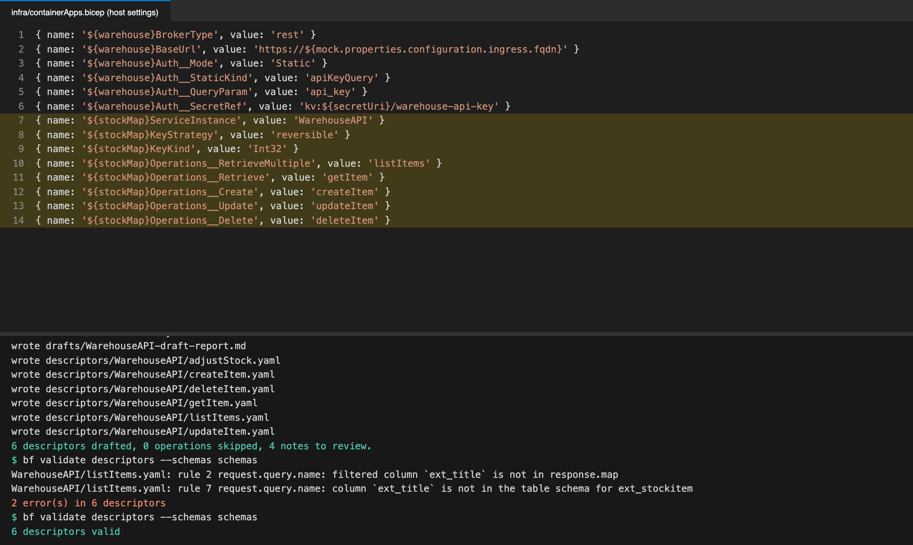

> To use the same API on another server (test, production), change only `BaseUrl` and the Key Vault reference in that environment's settings. Descriptors, schema and tables stay as they are. A different API is a new instance with its own name, descriptors and table: repeat steps 1 to 3.

### Step 3: generate the table and use it

1. Check, then generate:

   ```
   tools/dev/generate.sh WarehouseAPI BrokerForgeWarehouse --dry-run
   tools/dev/generate.sh WarehouseAPI BrokerForgeWarehouse
   ```

   This creates the solution, the table, its columns and any Custom APIs. Running it again only changes what differs.

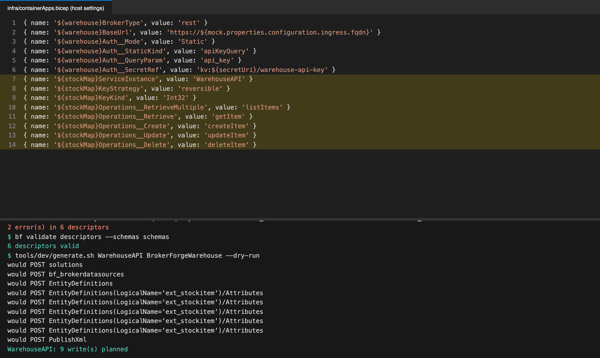

2. Open the table in Dataverse. Rows come straight from the API every time; nothing is copied.

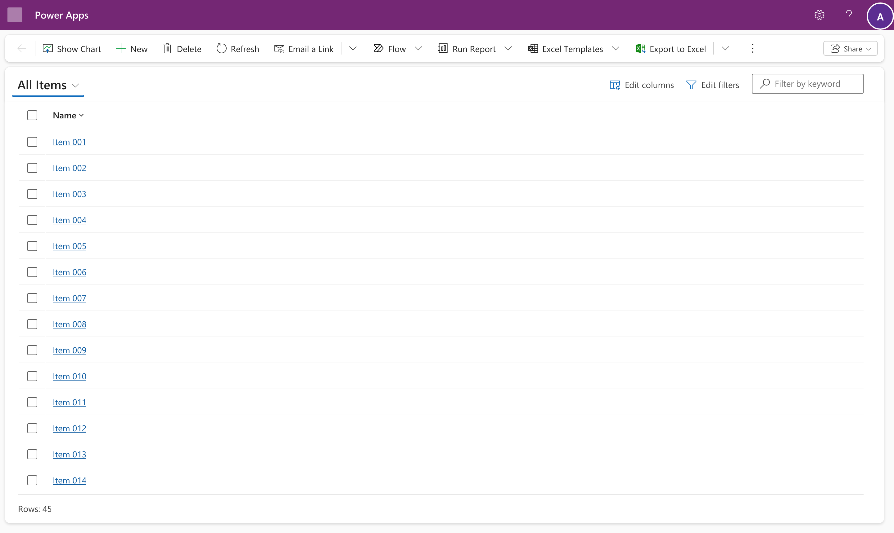

3. The generated view and form show only the name. Add the other columns: in the list use **Edit columns**; for everyone, add them to the view and the main form in the Power Apps maker portal.

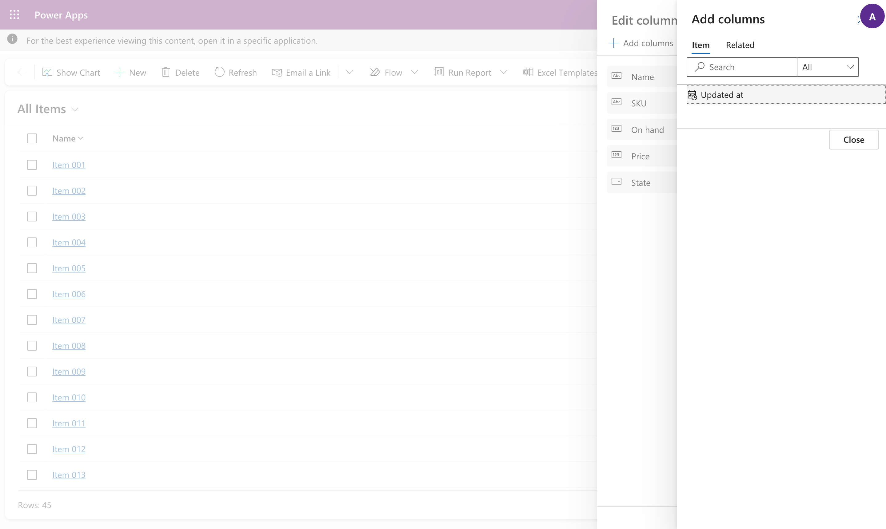

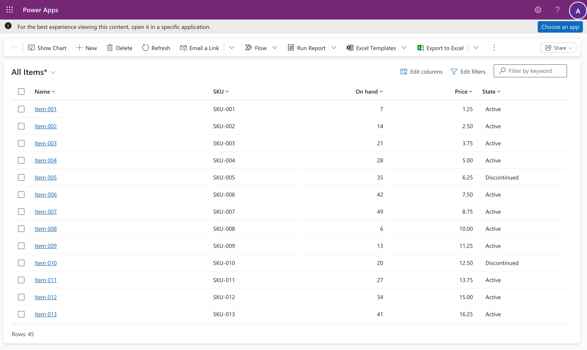

4. Forms work as you'd expect, each action calling the API:
   - opening a record reads it (`getItem`);
   - **Save** sends the change (`updateItem`);
   - **New** then **Save** creates it, and the API's new ID becomes the record's key (`createItem`);
   - **Delete** removes it (`deleteItem`).


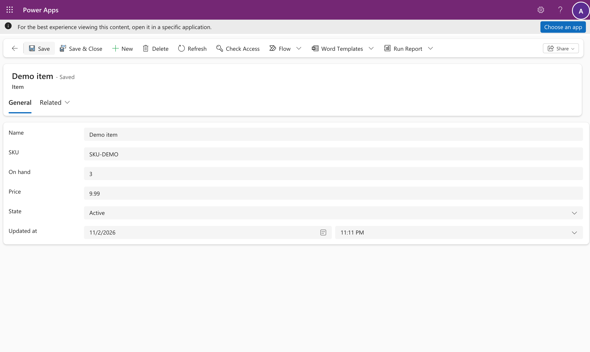

### What fails, and why

BrokerForge never returns partial or guessed results. A filter the descriptor doesn't declare is refused with a named error and a correlation ID for the host logs. To allow it, declare it in the descriptor, validate and deploy.

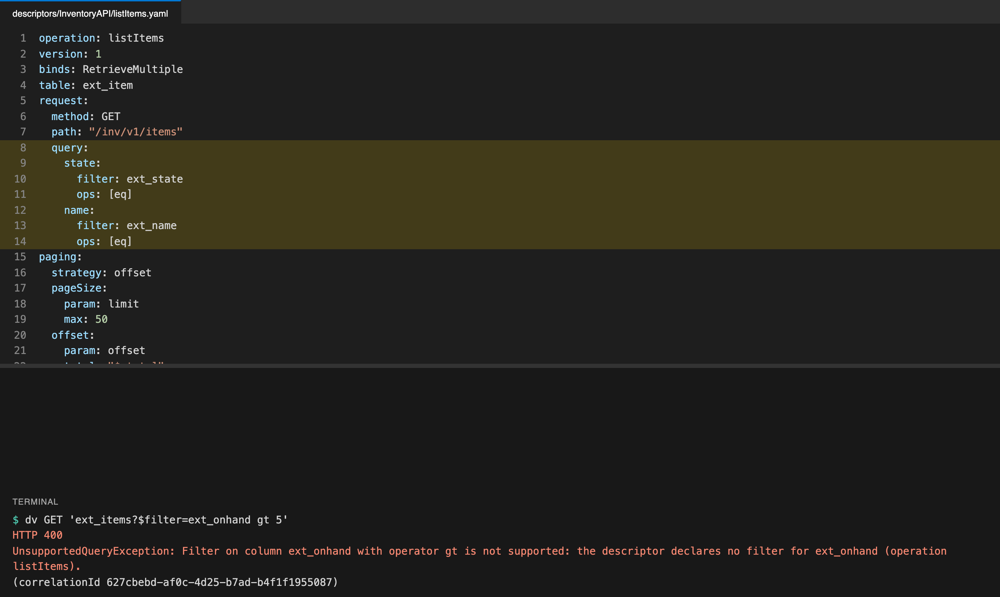

### Per-user services

When each person must see only their own data, use a per-user mode instead of an API key:

| Mode | The user | The host sends |
| --- | --- | --- |
| OAuth | signs in to the service once | that user's token from the service |
| Impersonate | signs in with their work account | a Microsoft Entra token for the service, as that user |
| SSO | enters their username and password for the service | those |

Set `Auth__Mode` (and `Auth__OAuthResource` for OAuth and Impersonate), generate as above, and give users a security role with Read (and Create) on the table: `bf generate` doesn't create the role. Then send them the connect page: `https://<host>/connect/<instance>`.

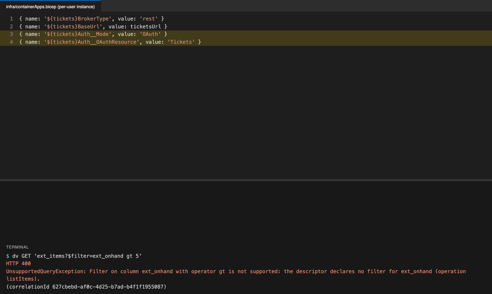

There is no fallback: a user who hasn't connected gets a message asking them to, never someone else's data.

## Part 2: connect your account (everyone)

The example is the Tickets table: each person sees the tickets their own Tickets account can see.

1. Open the table. Until you connect, it shows an error with the connect page address instead of rows.


2. Open that address. It signs you in with your work account and shows your connection's status. Select **Connect**.


3. Sign in to the service. (The demo service has its own simple page; a real one shows its own.)


4. You're back on the connect page: connected. Your sign-in is stored encrypted, for you only, and renewed when it expires.


5. Refresh the table: it shows your tickets. Records open on a form as usual.


6. The rows follow the account you connected. Connected as a different account at the service, the same table shows that account's tickets instead: each person sees their own.


7. To disconnect, open the connect page and select **Disconnect**. The list and forms ask you to connect again.


> Sign in to the connect page with the same work account you use in Dataverse. If someone else is signed in to Microsoft in your browser, use a private window.

## Where files live

| What | Where | Used by |
| --- | --- | --- |
| Swagger (OpenAPI) file | `openapi/<Instance>.yaml` | `bf draft`, once |
| Descriptors, one per operation | `descriptors/<Instance>/` | The host, every call |
| Table schema | `schemas/<Instance>.yaml` | `bf generate` |
| Draft report | the `--out` folder (not kept) | You, while reviewing |
| Base URL, authentication, object map | Host settings (`infra/containerApps.bicep` in dev) | The host |
| API keys and secrets | Key Vault | The host, through `kv:` references |
| Users' connections | The host's encrypted store | The host |

## When something goes wrong

| Message | Meaning | What to do |
| --- | --- | --- |
| `ConnectionRequiredException` | You haven't connected to this per-user service, or the connection expired | Open the connect page in the message |
| `UnsupportedQueryException` | That filter, sort or operator isn't declared | Use a declared one, or ask an administrator to add it |
| `SourceException` | The service answered with an error | Give the correlation ID to an administrator |
| `SourceTimeoutException` | The service didn't answer in time | Try again |
| `BrokerUnavailableException` | Dataverse couldn't reach BrokerForge | Try again; in dev the first call after a pause takes about 25 seconds |
| `MappingException` | The service's answer didn't match the descriptor | An administrator fixes the descriptor |

Every message ends with a correlation ID, which finds the request in the host logs.
