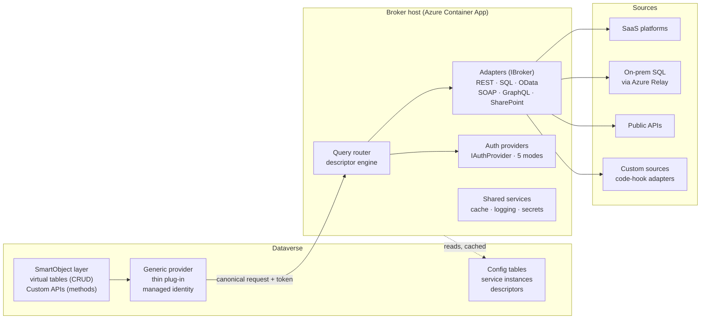
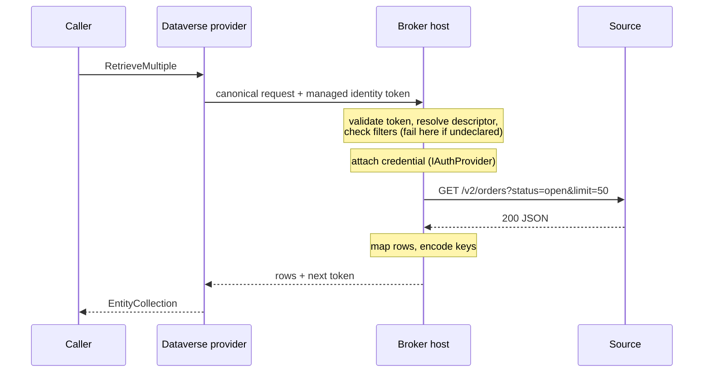

# BrokerForge — High-Level Design

Version 0.1 · Draft for review · 24 October 2026

## 1. Purpose

BrokerForge surfaces external data sources in Dataverse the way K2 service brokers surface them through SmartObjects. This document sets out the high-level design: components, contracts, security, runtime behaviour and delivery. It is the reference for the low-level design and for build.

| Item | Value |
| --- | --- |
| Status | Draft for review |
| Version | 0.1 |
| Predecessor | RESTVTP (REST virtual table provider) |
| Related | `docs/descriptor-spec.md`, `CLAUDE.md` |

## 2. Scope

### Goals

- One framework for many source types: REST, SQL, OData, SOAP, GraphQL and SharePoint, with new types added as adapters.
- Configure before code: onboarding a source is config plus generated metadata, not a new plug-in.
- K2 parity for authentication modes: Service Account, Static, Impersonate, SSO and OAuth.
- Method parity: CRUD through virtual tables, everything else through Custom APIs.
- Fail-loud semantics: unsupported queries, missing credentials and unmapped errors raise errors, never partial results.

### Non-goals

- Replicating data into Dataverse. BrokerForge is live pass-through; synchronisation is a separate concern.
- Cross-source joins in Dataverse queries. Composition happens in the broker host, if at all.
- Replacing Microsoft's Virtual Connector Provider where it already fits: SQL, SharePoint and Excel through standard connectors.
- Offline access, auditing and rollups on virtual tables. These are platform limits.

## 3. Requirements

### Functional

| ID | Requirement |
| --- | --- |
| FR-01 | Register a service instance with broker type, endpoint, authentication mode and instance config. |
| FR-02 | Discover a source's operations and schema (OpenAPI for REST; catalogue metadata for SQL and OData). |
| FR-03 | Generate virtual tables, columns and Custom APIs from reviewed descriptors. |
| FR-04 | Serve Retrieve, RetrieveMultiple, Create, Update and Delete against the source. |
| FR-05 | Translate filters, sorting and paging to the source; reject anything the descriptor does not declare. |
| FR-06 | Execute non-CRUD operations as Custom APIs with typed inputs and outputs. |
| FR-07 | Bind headers, query, path and body values from declared sources only. |
| FR-08 | Support all five K2 authentication modes per service instance. |
| FR-09 | Provide a connect page where users grant consent or store credentials for per-user modes. |
| FR-10 | Allow a code hook per operation when a descriptor cannot express it. |

### Non-functional

Targets are proposed and need confirming against a real source.

| ID | Requirement | Proposed target |
| --- | --- | --- |
| NFR-01 | Host overhead per call, excluding source time | 150 ms at p95 |
| NFR-02 | End-to-end call within the plug-in timeout | Fail at 90 seconds, inside the 2-minute sandbox limit |
| NFR-03 | Availability of the broker host | 99.9% |
| NFR-04 | No secrets in Dataverse rows, descriptors or logs | Always |
| NFR-05 | Every call traceable from Dataverse to source | Correlation ID end to end |
| NFR-06 | New REST source onboarded without code | Under one day for a well-specified OpenAPI |

## 4. Solution overview

BrokerForge has three tiers. Dataverse holds the SmartObject layer and a thin generic provider. An external broker host, the equivalent of the K2 host server, runs the adapters and authentication providers. Sources sit behind the host.



The provider converts each Dataverse message into a canonical request and sends it to the host. The host resolves the descriptor, authenticates, calls the source through the right adapter and maps the result back.

An optional in-sandbox fast path, RESTVTP as it stands today, stays available for simple public REST APIs that need no host features.

## 5. Component design

### 5.1 Dataverse solution

| Component | Responsibility |
| --- | --- |
| Generic provider plug-in | One assembly registered as the virtual table data provider. Converts Retrieve, RetrieveMultiple, Create, Update and Delete into canonical requests. Holds no source logic. |
| Custom API handler | Same assembly. Routes every generated Custom API to the host with its typed parameters. |
| Config tables | Service instances, operation descriptors, column maps, key maps and per-user connection status. See section 6. |
| Data source records | One per service instance, binding generated virtual tables to the provider. |
| Generator | Creates and updates tables, columns and Custom APIs from approved descriptors through the Web API. |
| Connect launcher | Command bar button and model-driven page linking users to the host's connect page. |

### 5.2 Broker host

Azure Container App in the client's subscription. Azure API Management in front of it is optional: used where the client's standard requires it, the host must be private in a VNet, or other consumers call the host directly. Without it, the host does token validation and throttling itself.

| Component | Responsibility |
| --- | --- |
| Ingress and trust | Validates the plug-in's managed identity token, environment and payload signature. |
| Query router | Resolves service instance and descriptor, then dispatches to the adapter. |
| Descriptor engine | Binds values, renders requests, shapes responses, applies paging and error maps. |
| Adapters (`IBroker`) | One per source type. Execute requests and return raw results. |
| Auth providers (`IAuthProvider`) | One per authentication mode. Attach credentials to outgoing requests. |
| Token and credential store | Per-user OAuth tokens and SSO credentials, encrypted, keyed by Entra object ID. |
| Connect page | Consent and credential capture for per-user modes. |
| Shared services | Descriptor cache, response cache, telemetry, Key Vault access. |
| Code hooks | Pre-request and post-response transforms for operations descriptors cannot express. |

### 5.3 Tooling

| Tool | Responsibility |
| --- | --- |
| SwaggerForge | Generates draft descriptors and table schema from OpenAPI. Extended with SQL and OData discovery. |
| Descriptor validator | Checks bindings, filter declarations, paging and error maps before publish. Runs in CI and in the generator. |
| Mock API | Node mock for local development and contract tests (carried over from RESTVTP). |

## 6. Configuration data model

Config lives in Dataverse so it travels with the environment. The host reads it through the Web API and caches it. No table holds a secret: credentials are Key Vault references or live in the host's store.

| Table | Purpose | Key columns |
| --- | --- | --- |
| `bf_serviceinstance` | One configured connection to a source | name, broker type, base URL, authentication mode, Key Vault secret reference, OAuth resource, enforce impersonation, async context rule, instance config (JSON) |
| `bf_operation` | One operation descriptor | service instance, operation name, binding (message or Custom API), descriptor (YAML), version, status (draft, approved, retired), code hook reference |
| `bf_objectmap` | Links a virtual table to its operations | service instance, table logical name, key strategy, Retrieve, RetrieveMultiple, Create, Update and Delete operations |
| `bf_keymap` | GUID to external key, for the key-map strategy only | object map, GUID, external key (JSON), last seen |
| `bf_userconnection` | Per-user connection status, no secrets | user, service instance, mode, status (connected, expired, revoked), last used |
| `bf_oauthresource` | OAuth endpoints and audiences, as K2 OAuth resources | authorise URL, token URL, scopes, audience, client ID, Key Vault secret reference |

Descriptors are versioned. A virtual table always calls the approved version; drafts run only in test environments.

## 7. Contracts

### 7.1 Canonical request

The provider sends one JSON shape for every message. It carries intent, not source syntax.

```json
{
  "contractVersion": "1",
  "correlationId": "8c1f…",
  "environmentId": "4b2e…",
  "serviceInstance": "OrdersAPI",
  "table": "ext_order",
  "message": "RetrieveMultiple",
  "caller": { "userObjectId": "e7a0…", "async": false },
  "query": {
    "allColumns": false,
    "columns": ["ext_name", "ext_status"],
    "filter": {
      "op": "and",
      "conditions": [ { "col": "ext_status", "op": "eq", "values": ["100000000"] } ],
      "groups": []
    },
    "orderBy": [ { "col": "ext_name", "desc": false } ],
    "page": { "size": 50, "token": null }
  }
}
```

Create and Update carry `record`; Retrieve and Delete carry `id` (the Dataverse GUID; the host decodes it); Custom APIs carry `customApi` and `inputs`. Record fields, inputs and outputs are `{ "name", "type", "value" }` where `value` is always an invariant string (ISO 8601 UTC for date-times, option set integers, GUIDs in "D" format) so both serialisers agree (D-09).

The host replies with `rows` and `next`, `record`, `id` (Create), or `outputs`, plus the correlation ID. Typed failures travel as an `error` envelope (`code`, `message`, `correlationId`, and `column`, `operator`, `path`, `statusCode` or `connectUrl` as relevant) with HTTP 200. Non-2xx means transport or trust: 401 trust failed, 400 not a canonical request, 5xx unexpected host failure, which the plug-in raises as `BrokerUnavailableException`.

Source of truth: `src/BrokerForge.Contracts`. Both sides serialise with `CanonicalJson` (DataContractJsonSerializer), so the plug-in needs no extra dependencies.

### 7.2 Broker contract

```csharp
public interface IBroker
{
    string BrokerType { get; }                       // "rest", "sql", "odata"
    BrokerCapabilities Capabilities { get; }         // operators, paging styles, transactions
    Task<DiscoveryResult> DiscoverAsync(ServiceInstance instance, CancellationToken ct);
    Task<BrokerResult> ExecuteAsync(RenderedRequest request, IAuthenticatedChannel channel, CancellationToken ct);
}
```

Adapters receive a rendered request and an authenticated channel. They never read secrets or descriptors directly.

### 7.3 Authentication contract

```csharp
public interface IAuthProvider
{
    AuthMode Mode { get; }   // ServiceAccount, Static, Impersonate, Sso, OAuth
    Task<IAuthenticatedChannel> AuthenticateAsync(ServiceInstance instance, CallerContext caller, CancellationToken ct);
}
```

A per-user mode with no stored credential throws `ConnectionRequiredException` carrying the connect URL. No provider falls back to another mode.

### 7.4 Operation descriptor

YAML with `request` (method, path, query, headers, body), `response` (rows, map, key, next), `errors` (status to exception), and optional `paging`, `steps`, `hook`, `cache` and `retry`. Values bind only from a fixed set of sources. The full schema, validation rules and worked examples are in `docs/descriptor-spec.md`.

## 8. Key strategy

Every virtual table row needs a GUID primary key; external keys are ints, strings or composites. The strategy is set per object map and cannot change once records are linked.

| Strategy | When | Behaviour |
| --- | --- | --- |
| Native GUID | Source key is already a GUID | Used as is |
| Reversible encoding (default) | Key fits in 15 bytes: int, long, short string | One type byte plus the key packed into the GUID. Decoded without lookup. |
| Key map | Composite or long keys | `bf_keymap` row written when a record is first returned; Retrieve looks it up |

UUIDv5 hashing is not offered: it cannot be decoded, so it needs the key map anyway.

Key-map consequences: a GUID not yet in the map returns not-found, even if the source has the record. Map rows are pruned by last-seen date. Lookups from native tables that store a key-map GUID break if the map row is pruned, so pruning must exclude referenced rows. How to detect references cheaply is open (section 16).

## 9. Security design

### 9.1 Authentication modes

| Mode | Credential sent to source | Source |
| --- | --- | --- |
| Service Account | Host managed identity or app registration (client credentials) | Entra ID |
| Static | API key, basic or certificate | Key Vault reference on the service instance |
| Impersonate | Delegated token for the calling user | Host token store, filled at connect |
| SSO | The user's stored credentials for that source | Host credential store, filled at connect |
| OAuth | User's access token from the authorisation-code flow | Host token store, refreshed automatically |

Plug-ins never receive the user's own access token, and the sandbox cannot prompt for or save credentials. Impersonate, SSO and OAuth therefore depend on what the user granted earlier on the connect page. A missing grant raises `ConnectionRequiredException` with the connect URL. This matches K2's Enforce Impersonation permanently on; there is no fallback to the service account.

### 9.2 Trust between hops

1. **Plug-in to host.** The plug-in gets a token through `IManagedIdentityService` (Power Platform managed identity). The host validates audience, tenant and environment ID, with API Management repeating the token check at the edge where it is deployed. The caller's Entra object ID in the request is trusted only because the caller is that authenticated plug-in.
2. **Host to source.** The service instance's `IAuthProvider` attaches the credential. On-prem traffic goes through Azure Relay Hybrid Connections or a VNet; per-user Windows authentication through the relay is out of scope.

### 9.3 Async and workflow calls

Async plug-ins and Power Automate calls may run with no interactive user. Each service instance's async context rule picks one: run as the host's service identity (K2's behaviour for workflow server events), or require a stored credential for the user who triggered the run.

### 9.4 Authorisation

- Dataverse enforces table-level privileges on virtual tables. They are organisation-owned, so there is no row-level security.
- Per-user row filtering comes from the source, through the per-user modes.
- The host checks the calling environment is allowed for that service instance.

### 9.5 Secrets and data

- Secrets live in Key Vault or the host store, encrypted at rest; never in Dataverse rows, descriptors, logs or traces.
- Response caching is off by default for per-user modes. When on, cache keys include the user's object ID.
- Logs record correlation ID, operation, status and timing; payload logging is opt-in per operation, with field redaction.

## 10. Runtime flows

Every message follows the same path; only the descriptor and payload change. A list query shows it end to end.



| Message | Trigger | Descriptor | Source call (Orders example) | Returns |
| --- | --- | --- | --- | --- |
| RetrieveMultiple | View, List rows, Web API query | `listOrders` | `GET /v2/orders` with mapped filters and paging | Rows and next-page token |
| Retrieve | Form open, Get a row | `getOrder` | `GET /v2/orders/{id}` after key decode | One record |
| Create | Form save, Add a row, Web API POST | `createOrder` | `POST /v2/accounts/{accountId}/orders` with body template | New GUID from `$.id` |
| Update | Form save, Update a row | `updateOrder` | `PATCH /v2/orders/{id}`, changed columns only | Nothing |
| Delete | Delete command, Delete a row | `deleteOrder` | `DELETE /v2/orders/{id}` | Nothing |
| Custom API | Flow unbound action, Power Fx, JavaScript | `submitOrder` | `POST /v2/orders/{id}/submit` | Output parameters |

When a per-user credential is missing, the host replies with `ConnectionRequiredException` at the authentication step. The provider raises it as a Dataverse error that model-driven apps show with the connect link.

## 11. Error handling

The rule is fail loudly: the caller always sees a specific error rather than a partial or approximate result.

| Condition | Detected at | Raised as |
| --- | --- | --- |
| Filter, sort or operator not declared | Descriptor validation | `UnsupportedQueryException`, naming the column and operator |
| Missing per-user credential or consent | Authentication | `ConnectionRequiredException` with connect URL |
| Expired or revoked token that cannot refresh | Authentication | `ConnectionRequiredException`; `bf_userconnection` set to expired |
| Source 4xx mapped in descriptor | Response mapping | The mapped Dataverse error (for example not found, conflict) |
| Source 4xx or 5xx not mapped | Response mapping | `SourceException` with status, correlation ID and redacted body excerpt |
| Timeout | Host | `SourceTimeoutException` at 90 seconds, inside the sandbox limit |
| Response shape does not match map | Response mapping | `MappingException` naming the path |
| Host unreachable, or host trust rejected the plug-in | Provider | `BrokerUnavailableException` |
| Unknown service instance, table, operation or Custom API; environment not allowed; invalid descriptor; auth mode not available | Host | `BrokerConfigurationException` |

Retries happen only in the host, only for idempotent operations, and only for transient failures (429, 503, network). Create calls are retried only when the descriptor supplies an idempotency key. Every error carries the correlation ID back to the user.

## 12. Performance, scaling and limits

### Scaling

- The host is stateless apart from its stores. Container Apps scale on concurrent requests.
- Descriptors and service instances are cached in the host and refreshed on publish.
- Response caching is per operation, with a declared lifetime. Off by default; never shared across users in per-user modes.
- Per-source concurrency limits and token-bucket throttling protect sources from Dataverse fan-out, such as a large view refresh.

### Limits to design around

| Limit | Effect | Mitigation |
| --- | --- | --- |
| Plug-in sandbox timeout (2 minutes) | Slow sources fail the whole message | Host timeout at 90 seconds; slow operations move to async Custom APIs |
| Every view and form load is a live call | Source latency becomes user latency | Response caching where data allows; narrow default columns |
| Dataverse page sizes | Views request pages the source may not match | Descriptor maps page size and token; host buffers when the source page is smaller |
| Extra network hop | Added latency on every call | Host in the same region as the environment; in-sandbox fast path for simple public REST |
| Source rate limits | 429s under load | Throttling and retry in the host, surfaced as errors when exhausted |

## 13. Observability and operations

- **Tracing.** The provider writes the correlation ID to the plug-in trace log. The host carries it through Application Insights to the source call, so one ID joins Dataverse and source logs.
- **Metrics.** Calls, latency, errors and throttling per service instance and operation; token refresh failures per mode.
- **Alerts.** Error rate per service instance, host availability, Key Vault access failures, OAuth refresh failure spikes.
- **Health.** A health operation per service instance, callable from an admin page, tests connectivity and authentication without touching data.
- **Admin page.** Model-driven app over the config tables: instances, descriptor versions, user connections (status only), recent errors by correlation ID.
- **Runbooks.** Rotating a static secret; re-consenting after an OAuth client change; disabling a service instance; revoking a user's stored credentials.

## 14. ALM and deployment

### Dataverse

| Artefact | Packaging |
| --- | --- |
| Provider plug-in, config tables, admin app | BrokerForge core managed solution |
| Generated virtual tables and Custom APIs | One solution per source, depending on core |
| Data source records | Per source solution; environment-specific values through environment variables |
| Service instances and descriptors | Config data, not solution components: deployed by pipeline from Git |
| Host URL, allowed environment | Environment variables |

Descriptors live in Git as YAML, one file per operation. CI runs the descriptor validator and contract tests against the mock API, then the pipeline writes approved versions to `bf_operation`. Generated table schema can be held as code with DataverseToCode.

### Broker host

- Infrastructure as code (Bicep): Container App, Key Vault and Application Insights, plus API Management and Relay as optional modules.
- Container image built and versioned in CI; promoted dev, test, prod with the same image.
- One host per client tenant. Environments within the tenant share it, separated by environment ID checks, or get one each where isolation is required.

## 15. Risks

| Risk | Likelihood | Impact | Mitigation |
| --- | --- | --- | --- |
| Unverified provider SDK surfaces (`entitydataprovider` query, `IEntityDataSourceRetrieverService`) behave differently from assumptions | Medium | High | Spike in phase 0 before any adapter work |
| Virtual table platform gaps (offline, auditing, row-level security, Power BI) block a client use case | High | Medium | State gaps at scoping; route reporting to the source or a sync |
| Users experience live-call latency as slowness | Medium | Medium | Caching, narrow views, latency targets per source |
| Per-user modes need a connect step users skip | Medium | Medium | Clear error with connect link; connect prompt on first use |
| Microsoft extends the Virtual Connector Provider into the same space | Medium | Medium | Focus on arbitrary REST, Custom API parity and fail-loud semantics |
| Host becomes a single point of failure for every source | Low | High | Multi-replica deployment, health probes, availability alerting |
| Key-map growth or pruning breaks lookups | Low | Medium | Prefer reversible encoding; prune only unreferenced rows |
| Descriptor language grows into a programming language | Medium | Medium | Fixed binding set; code hooks for the rest |

## 16. Decisions and open questions

### Decisions taken

| ID | Decision | Reason |
| --- | --- | --- |
| D-01 | Brokers run in an external host, not the sandbox | Timeouts, network reach, library freedom, one place for secrets |
| D-02 | CRUD through virtual tables; everything else through Custom APIs | Virtual tables cannot express arbitrary methods |
| D-03 | No fallback to the service account in per-user modes | Fail loudly; avoids silent privilege change |
| D-04 | Reversible key encoding by default; key map only when needed | Avoids state for most sources |
| D-05 | Descriptors as YAML in Git, deployed as config data | Reviewable, testable, environment-independent |
| D-06 | Name: BrokerForge | Fits SwaggerForge and Control Forge; keeps the K2 lineage visible |
| D-07 | API Management is optional, decided per client | Not every client runs APIM; the host already validates tokens, throttles and logs |
| D-08 | Add `BrokerForge.Abstractions` (net8.0) for `IBroker`, `IAuthProvider`, `ServiceInstance` and `ObjectMap` | Lets Auth and Adapters depend on contracts rather than on each other; the plug-in never references it |
| D-09 | Canonical values are invariant strings with a type tag; serialised with DataContractJsonSerializer on both sides | Works in the net462 sandbox with no extra assemblies; one serialiser means the wire format cannot drift |
| D-10 | Add `BrokerConfigurationException` to the exception set | Unknown instance, operation or table and disallowed environments are neither source nor query errors and must still fail loudly |
| D-11 | Undeclared queries are rejected in the host before authentication | No credential is used, and no source is called, for a request that will fail anyway |

### Open questions

- [ ] Where per-user tokens and SSO credentials live: host-side encrypted store or Key Vault per user.
- [ ] How users reach the connect page from model-driven apps and canvas apps.
- [ ] Host language: C# for parity with the plug-in, or a mix where adapters benefit.
- [ ] Composite operations across brokers: in scope for v1 or later.
- [ ] How to detect native-table references to key-map GUIDs before pruning.
- [ ] Licensing and packaging model if BrokerForge is offered beyond client engagements.
- [ ] How a Custom API call finds its host and service instance, since it has no virtual table data source (environment variables for the host, plus a per-API service instance recorded by the generator, is the likely answer).
- [ ] Source of `environmentId` in the canonical request (data source column, organisation ID or a token claim), confirmed in phase 0.

## 17. Delivery phases

Phases are sequenced by risk; durations are not yet estimated. Acceptance criteria per phase are in `CLAUDE.md`.

| Phase | Scope | Exit criteria |
| --- | --- | --- |
| 0. Spike | Verify the two provider SDK surfaces; managed identity call from plug-in to a stub host | Both surfaces confirmed in a real environment |
| 1. Core | Canonical contract, host skeleton, REST adapter from RESTVTP, Service Account and Static modes, reversible keys | Orders mock API fully usable through a virtual table |
| 2. Tooling | SwaggerForge descriptor output, validator, generator, CI pipeline | New REST source onboarded with no code |
| 3. Per-user security | OAuth, SSO and Impersonate modes, connect page, async context rule | A user-scoped source enforces per-user data |
| 4. More adapters | SQL via Relay, OData, then SOAP and GraphQL as demand dictates | Each adapter passes the shared contract tests |
| 5. Hardening | Caching, throttling, admin app, runbooks, key map | NFR targets met against a real client source |
